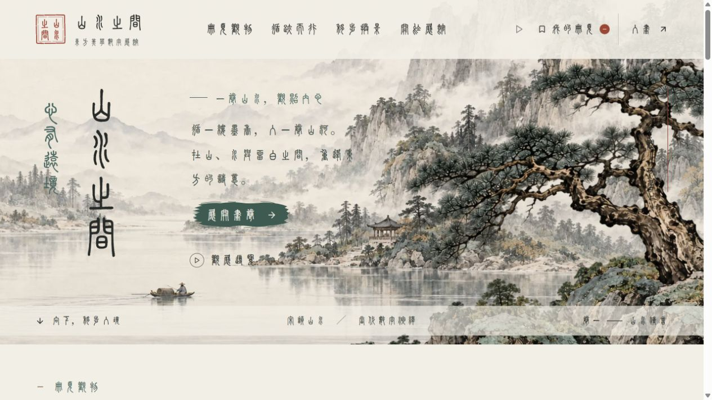
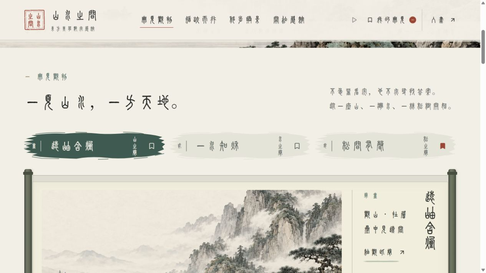
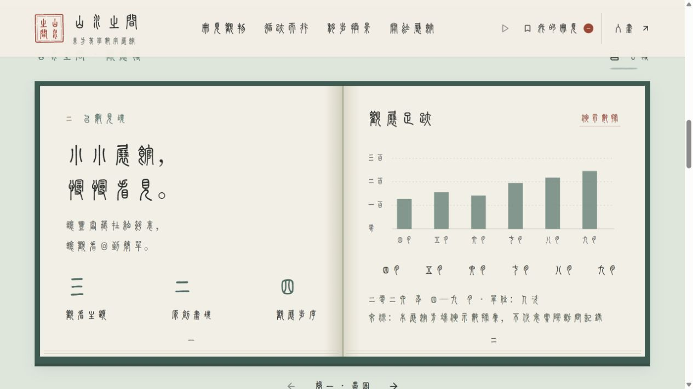
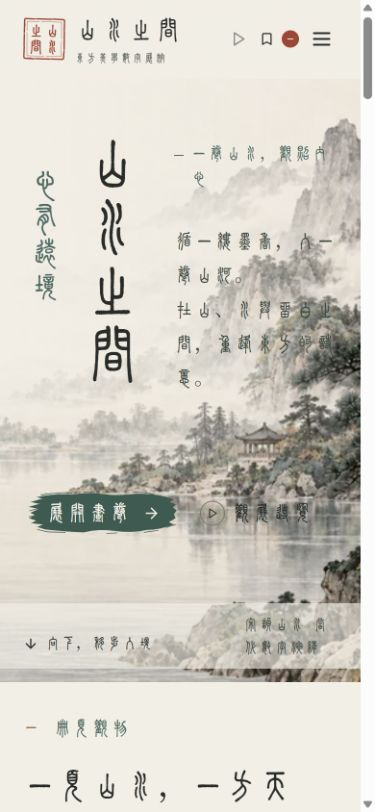
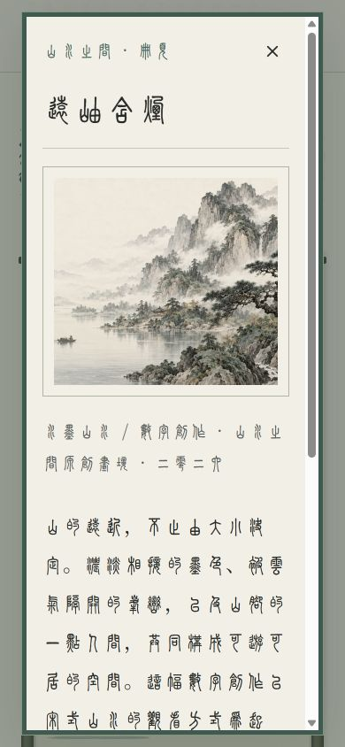
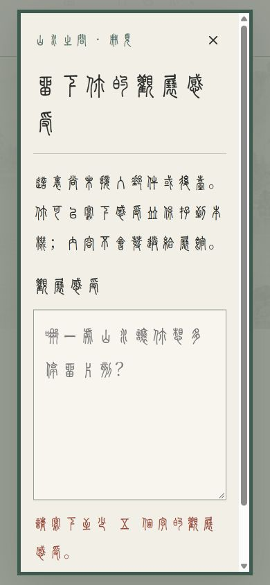
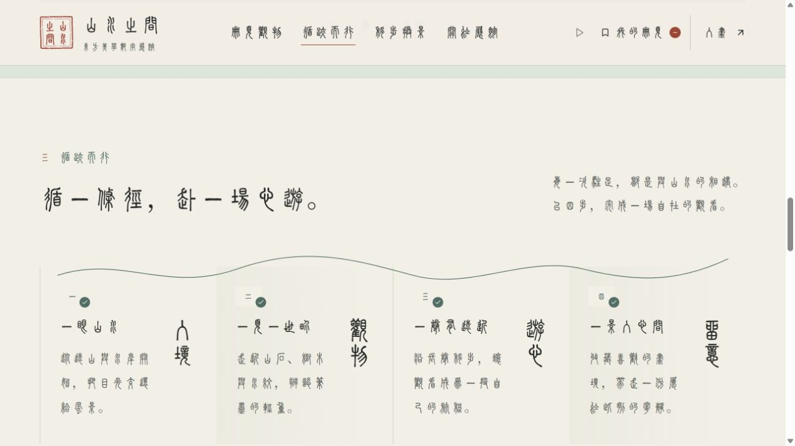
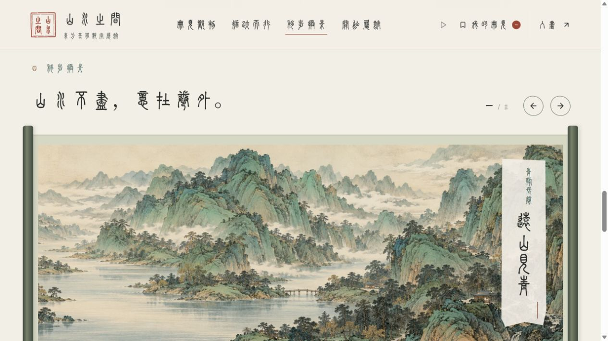
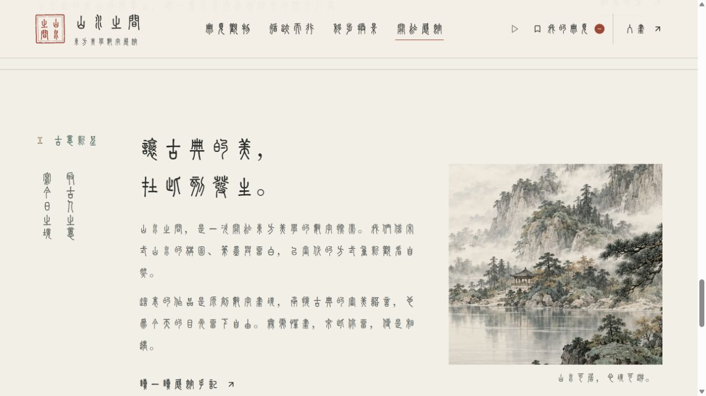
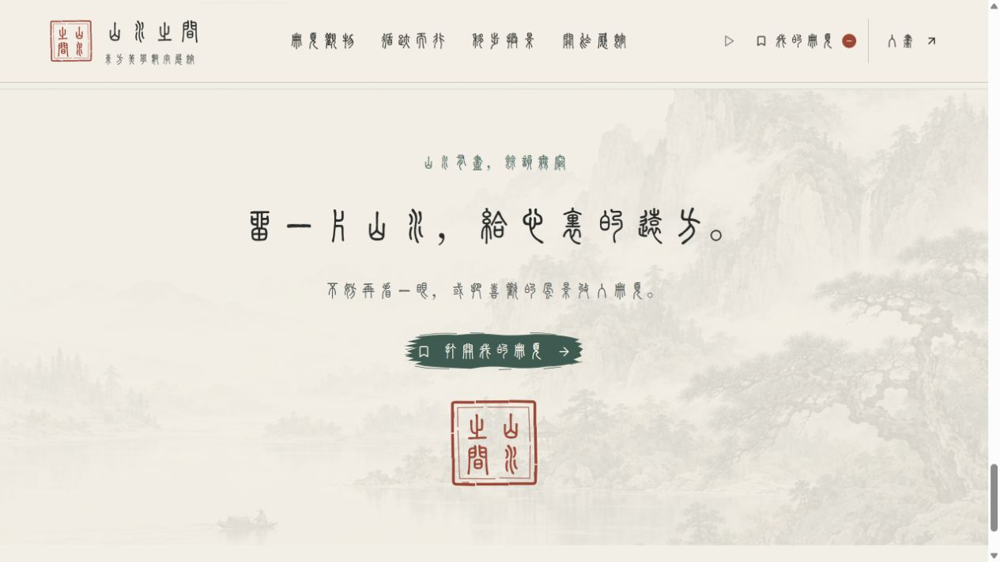

# 山水之间：细节级诊断

日期：2026-10-09。对象：当前本地运行版 http://127.0.0.1:5180/ 。本轮仅诊断，未修改网站代码。

## 范围与方法

使用Codex内置浏览器查看当前页面，保存本轮真实截图，读取已呈现元素的字号、颜色、尺寸及表单状态；辅助核对当前样式、动效配置、图片及字体文件。桌面采用浏览器默认尺寸，移动端显式设置390×844，结束后恢复默认尺寸。未使用上一轮截图作为本轮依据。

整体质感评分：84/100，属于设计评估，不是无障碍认证。

优势：山水层次与竖排题字建立了鲜明辨识度。手卷、书簿、篆印和笔刷控件已形成连贯的文化语言。纸白、松石青、墨黑与少量朱砂保持克制，已有选中状态、表单校验和静态动效模式。

最突出的问题：小字号篆字和手机孤行降低辨识度；部分触控区偏小、错误标记不够完整；图表月份重复，笔刷散锋的节奏还可精细化。

## 核验记录

| 步骤 | 当前状态 | 依据与限制 |
|---|---|---|
| 一：桌面首屏 | 良好 | 构图完整，主操作清楚；品牌副标15px，较细小。 |
| 二：册页与选卷 | 良好，待润色 | 选中与收藏状态可见；笔刷散锋较规则。 |
| 三：观展簿 | 可用，待精简 | 翻页后正确出现月录；墨图内外重复呈现月份。 |
| 四：手机首屏 | 局部待修复 | 无横向溢出；题签末字孤行，品牌副标12px；菜单33×38、收藏图标38×40、翻页38×38。 |
| 五：手机详情 | 良好 | 弹层无横向溢出；正文23px、行高43.7px；图片说明与正文之间可略收间距。 |
| 六：反馈错误状态 | 基本可用，待补全 | 空输入被拒绝，aria-invalid=true；朱砂提示出现，但输入框边缘仍为普通灰绿；标题末字孤行。 |
| 七：循迹而行 | 良好 | 现有节点、纵题和墨线无需重排。 |
| 八：移步换景 | 良好 | 下一景的序号、图像和文字同步更新；本轮处于减少动态效果模式，未评估动画主观流畅度。 |
| 九：手记区 | 良好 | 图文、正文与竖题保持统一；没有必要换布局或继续添加装饰。 |
| 十：收尾 | 良好 | 朱砂双框与二乘二篆印已经实现；远山轻淡，收束清楚。 |

## P0：一天内快速修复

- 【手机题签、反馈标题末字孤行】→【标题按语义断行；题签只微调可用宽度或字号，不改内容、不强行挤字】→【消除零碎断行，首屏与表单更完整】。
- 【辅助篆字仅12—15px，细笔画辨识成本高】→【品牌副标手机试调14px、桌面17px；保留字库与字距零，不全站描边或伪加粗】→【提升小字清晰度，不改变风格】。
- 【部分图标点击区30—38px偏紧】→【用透明内边距将主要触控区试调至44×44px，不放大图标、不改变外形，避免热区相互重叠】→【减少误触】。这是舒适度建议，不直接判定为标准违规。
- 【墨图内外重复显示四月至九月】→【保留现有可键盘操作的月份行，仅去除图内重复视觉标签，保留读屏说明与数据】→【减少扫描噪声，不改变图表与任务路径】。
- 【错误提示与输入框未同步标记】→【aria-invalid为真时仅将边缘切换为现有朱砂色，保留文字提示；与输入区间距统一为8—12px】→【不只依赖颜色，更容易定位问题】。

## P1：三天内质感提升

- 【笔刷散锋和短墨线的视觉权重略高】→【保留轮廓，仅降低细笔线约10%—15%的不透明度；统一普通、悬停与选中色值】→【更自然、更安静，操作仍清楚】。
- 【手机详情图片说明与正文的间隔稍松】→【现有册页间距由32px试调至24—28px，保留23px正文和1.9行高】→【减少不必要滚动，不牺牲阅读舒适度】。
- 【多个交互过渡配置约一秒，仍有收紧空间】→【正常动效模式下比较翻页0.85—0.95秒、换卷0.75—0.85秒、导航0.65—0.8秒；不增复杂转场，保留可中断机制】→【保留开卷感并减轻视觉等待】。这是参数候选，不是本轮已验证的性能结论。
- 【浏览器小图标仍为青底普通山字，与朱砂篆印不一致】→【沿用现有印章生成小尺寸图标，仅校准线宽与像素对齐】→【统一品牌识别，不更换Logo】。依据为当前index.html。
- 【小篆字体约21.8MB，首访加载风险高于图片】→【保留现有预加载与后备字体，部署时核对传输压缩和版本化长缓存；不裁字、不转换原始字库】→【降低传输与重复加载成本，保留字体原貌】。当前图片已为WebP，最大画境资源约292KB，不建议盲目降质。

## P2：长期润色

- 【叠画上的细篆字可读性随画面明暗变化】→【只在文字后现有纸色覆盖层上做2%—4%透明度试调，逐点验收，不压灰整幅山水】→【保护笔墨层次与文字清晰度】。
- 【小尺寸印章的断墨线可能因像素密度损失细节】→【在不同像素密度下检查，必要时做不超过1px的光学校准，保持四字、右列先读、双框和字位】→【缩小时仍有篆刻辨识度】。
- 【空收藏、断网和图片失败状态尚未在本轮触发】→【先验证已有状态；确认缺失后仅在原位置补简短提示、纸色底与既有重试入口，不加新页面】→【补齐异常体验，避免无依据地改动正常流程】。

## 保留原则

一：保留原貌。主配色、原始小篆、山水素材、竖排首屏、八个区域与内容顺序不改。

二：参数优先。先改字号、间距、透明度、线宽与时长，不新增大装饰、不更换按钮轮廓；纸色上的辅助色#59615B对#F3EFE6的理论对比度约5.57:1，无须全站加黑。

三：反馈优先。保留选卷、翻簿、换景、收藏、详情与本地反馈的路径；所有微调继续保留键盘焦点、准确数字和减少动态效果。

普通文字的对比度基线为4.5:1，大字为3:1；薄笔画的名义合格不等于实际易读。参考：https://www.w3.org/WAI/WCAG22/Understanding/contrast-minimum.html 。未据此宣称全站无障碍合规。

## 待确认与边界

需确认目标读者的篆字熟悉度、正常动效模式下的节奏偏好、真实手机键盘弹起后的表单空间，以及正式部署的慢网和缓存表现。字号与时长建议是待比较的候选值，不是已经实施的变更。

本轮浏览器启用了减少动态效果，因此动画节奏建议仅结合当前配置提出。没有实测真实手机硬件、Safari、Firefox、完整读屏流程，也没有触发图片下载失败或清空用户已有收藏。保持现有字体和收藏数据不变。

宋韵山水配现代全站篆字应理解为数字艺术转译，而非声称宋代界面的历史复原；本轮未发现足以确认的典故误用。不建议仅因朝代来源不同就更换既有主字体或文化体系。

## 本轮截图

### 一：桌面首屏

### 二：册页与选卷

### 三：观展簿

### 四：手机首屏

### 五：手机详情

### 六：反馈错误状态

### 七：循迹而行

### 八：移步换景

### 九：手记区

### 十：收尾

